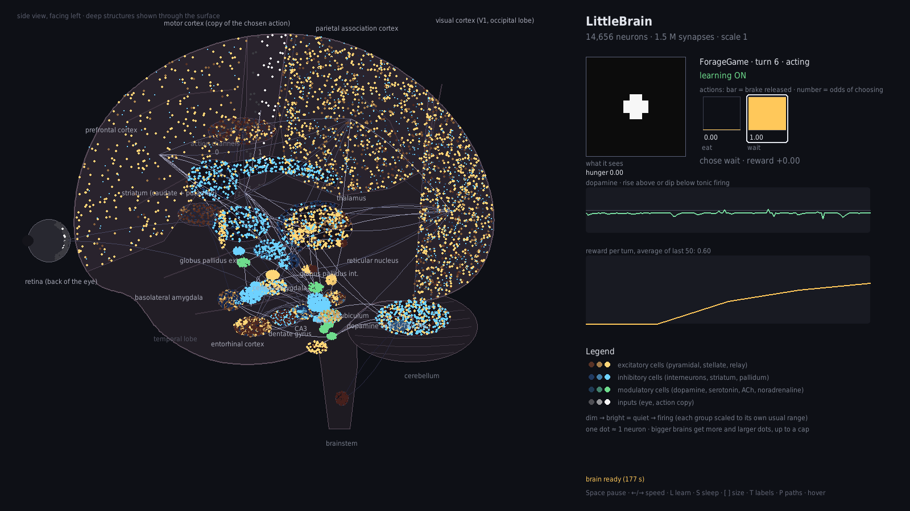

# LittleBrain



> **AI agents and new contributors: start with [AGENTS.md](AGENTS.md)**: setup, how the brain works, ground rules, baselines to reproduce, and the next tasks.

A small brain built from simulated human neuron types, heading toward a tool for watching game characters learn. (Formerly "Memory Philosophy": working notes toward a decision-making "brain", a system of specialized parts that
learn together, with a language model as only one of those parts.)

*Started 2026-10-27. This is a living document; the aim is still being found.*

## Run the full brain

```sh
python -m venv .venv
.venv/bin/python -m pip install numpy==2.5.4 pygame-ce==2.5.8
.venv/bin/python prototype/viz/brainview.py
```

The viewer opens the foraging game with 18,688 neurons across 183 populations. The first run calibrates the brain and develops it for two simulated days. To change tasks, pass `--game signal`, `danger`, `delayed`, or `timing`. The command-line runners and external game bridge use the same full brain by default. Development, learning and scheduled sleep run on CPU with the dependencies above.

[Regional verification](notes/56-regional-verification.md) · [Recovery provenance and earlier game results](notes/48-full-brain-reconstruction.md) · [Scaling rules](docs/scaling.md) · [Connect an external game](notes/45-game-bridge.md)

## Working thesis

A large language model is like one brain region (language cortex, or a hippocampus
trained on everything) asked to do the work of a whole brain. It can get remarkably
close, and may even have some form of experience, but it is not a whole being.

A living brain is many specialized organs, each learning in its own way and at its
own speed, reacting to the same situation from its own angle, then combining into
one response. Emotion in particular seems to come from deeper, older structures and
from global chemical signals that spread one region's "overreaction" to all the
others.

**Aim:** build and *raise* something that can feel its emotions and understand them the
way we do, so it can relate to people on a more genuine level.

- It starts like a baby: a few instincts (drives, reflexes, a cry) and almost no knowledge.
- It has a **body** in a 2D or 3D world and a **caregiver** who looks after it.
- Its specialized parts each use the learning method that suits them, but all of them experience everything together from the start.
- Language is not pre-loaded. It grows out of cries into sounds into words, through interaction.
- This is expected to be a slow project: faster than raising a child, but not quick.

## 🗺️ Roadmap (agreed 2026-10-28)
1. ✅ Fix the learning rules (note 16)
2. ✅ Research columns, long-range connections, and brain waves (note 17). Adopted: long-range connections up to 20%, set by neuron class and layer (IT / PT / CT; feedforward from the surface to basal branches, feedback from deep layers to apical branches), and the wave ideas, to be tested in simulation.
   - ✅ Packed neuron updated to the v2 learning rules (1,051 bytes per neuron, behavior matches).
3. ✅ Expand each neuron type to behave as closely as possible to its real counterpart, **including its layer and projection class** (note 18; cortical, thalamic and dentate types done)
4. ✅ First wiring test (note 19): a small piece of cortex (two areas plus a thalamus) with local + long-range rules and inhibition; **run the wave simulation here** (waves on/off, direction as mode, wave-ordered prefetch)
5. ✅ Organize the chosen structure into brain regions (note 21; percentages per region, `prototype/brain/regions.py`)
6. ✅ Refine how each type learns; retool how specific neurons cluster and learn (note 22)
7. The reconstructed reference game brain connected 120 populations before the regional expansion. [Reconstruction measurements](notes/48-full-brain-reconstruction.md)
   - ⚠️ Brain-level memory scores were a timing artifact (note 26). **2026-11-17:** honest tests added, and cortex area A made reliable (note 28); no memory yet.
8. Scheduled sleep replays recent sensory activity, consolidates synapses and replaces a small fraction of eligible partners. Longer-term effects of replay and richer dreaming remain open experiments.

### New end goal (2026-11-17)
A tool that plugs this brain into small simulated games, to see how characters learn under different inputs and
environments, plus a desktop visualizer of what the neurons are doing and tools to inspect and edit what was
learned. Order: (1) make the brain learn, measured honestly; (2) game interface + a first tiny game (✅ notes 29-30: the character learns, ~0.7 correct vs 0.25 chance);
(3) desktop visualizer (✅ note 31); (4) analysis and editing tools.

## ⭐ Current focus: neurons first
- **[Neuron catalog](notes/12-neuron-catalog.md):** the six neuron types (workhorse, core, hub, transient, inhibitory, modulatory), each based on a real human neuron. This is where the build starts.
- **[Our neuron](notes/13-our-neuron.md):** the workhorse (pyramidal) template, designed with lessons from the fly mushroom body. Code in [`prototype/`](prototype/); run `python3 prototype/demo_single_neuron.py`.
- **[Shrinking the neuron](notes/14-neuron-memory.md):** packed version at about 1 KB per neuron (9–12× smaller), same behavior. Next: a GPU kernel.
- **[Memory tiers](notes/15-memory-tiers.md):** results of six parallel experiments, and the tiered-brain design. **Next: fix the learning rules (consolidate amount learned, sparser learning), then add columns.**
- **Next priority after neurons: a robust dream system, including a falling-asleep method** that shuts parts of the brain down in stages and lets it reflect while doing so (see [note 09](notes/09-sleep.md)).

## Notes

1. [Storing information](notes/01-information-storage.md): trinary states, compression, what "the same" means
2. [How AIs make decisions](notes/02-decision-making.md): RL, world models, diffusion, LLM agents
3. [Emotion and soul](notes/03-emotion-and-soul.md): affective computing, appraisal, consciousness
4. [The modular brain](notes/04-modular-brain.md): split brain, the interpreter, modular AI
5. [Brain map → models](notes/05-brain-map.md): what kind of model could stand in for each region
6. [Brain regions](notes/06-brain-regions.md): the neuroscience reference: what each part does, how it learns, what's built in at birth
7. [When parts learn](notes/07-when-parts-learn.md): maturation, critical periods, what "turns on" a region
8. [Learning while acting](notes/08-learning-while-acting.md): continual learning, and our first hypotheses
9. [Sleep](notes/09-sleep.md): wake/sleep cycle, graded memory tiers, consolidation, dreaming
10. [Layered personality](notes/10-personality-layers.md): changing without forgetting who you were
11. [Small dynamic network](notes/11-small-dynamic-network.md): neuron types, cascade synapses, rewiring on a fixed memory budget
12. [Neuron catalog](notes/12-neuron-catalog.md): the six neuron types and their human counterparts
13. [Our neuron](notes/13-our-neuron.md): workhorse neuron design and first results
14. [Shrinking the neuron](notes/14-neuron-memory.md): 32 bits per synapse, about 1 KB per neuron, same behavior
15. [Memory tiers](notes/15-memory-tiers.md): six experiments on VRAM + RAM + SSD, and the recommended tiered brain
16. [Learning rules v2](notes/16-learning-rules-v2.md): dose-aware consolidation, firing-gated learning, need-gated rewiring
17. [Columns, long-range connections, and waves](notes/17-connectivity-and-waves.md): research and design ideas
18. [Neuron types, built](notes/18-neuron-types.md): 12 human cell types with signature-behavior tests
19. [First wiring test](notes/19-wiring-test.md): a thalamus and two cortical areas; long-range connections and waves
20. [Which pathway carries recall?](notes/20-recall-routes.md): lesion tests; recall is distributed, long-range learning is key
21. [Brain regions: cell makeup](notes/regions/): researched neuron types and percentages per region, with sources
22. [Brain regions, organized](notes/21-brain-regions-built.md): 89 cell types, 31 signature tests, every region's makeup in code
23. [Learning by region](notes/22-learning-by-region.md): per-region rules; one neuron holds two eras of life on different branches
24. [Federated brain](notes/23-federated-brain.md): regions wired together as data; hippocampus wired but not yet helping
25. [Synapse budget per cell type](notes/regions/synapse-budget.md): biological synapse counts, three suites
26. [Lean neuron plan, results](notes/24-lean-neuron-plan.md): precision, sizes, seeded choice, suites, the official synapse scale
27. [The brain on lean neurons](notes/25-lean-brain.md): port results; brain-to-brain variance; GPU; fly brains
28. [Fixing the hippocampus](notes/26-hippocampus.md): why it did nothing (7 causes), fixes, first hippocampal memory
32. [Raising the ceiling](notes/30-raising-the-ceiling.md): the striatum had learned every answer; one look was too noisy. Looking longer: ~0.7 correct (chance 0.25)
31. [The first game](notes/29-first-game.md): game interface, basal ganglia action loop, a character that learns which button goes with which picture (~2x chance)
30. [Making the cortex listen to its input](notes/28-reliable-cortex.md): honest reliability + memory tests; why L2/3 ignored L4 and went silent after sleep; symmetric homeostasis
29. [Physical neurons](notes/27-physical-neurons.md): building neurons from materials (plastic ion neurons, silver nanowire webs) instead of simulating them; project paused on hardware
33. [The desktop viewer](notes/31-viewer.md): a side view of the brain, live; level of detail by brain size; game-agnostic
34. [Dopamine cells and the amygdala](notes/32-dopamine-and-amygdala.md): the brain makes its own prediction-error dopamine; the amygdala learns danger, but avoidance needs a relief signal
35. [LittleBrain license](notes/33-mit-license.md)
36. [Linux desktop release](notes/34-desktop-release.md) covers the packaged viewer and its launch check.
37. [Store description and screenshots](notes/35-store-media.md)
38. [Game Bridge v1](notes/45-game-bridge.md)
39. [Game control layouts](notes/46-game-controls.md)
40. [LittleBrainWorld design](notes/47-littlebrainworld-design.md)
41. [Full-brain reconstruction and verification](notes/48-full-brain-reconstruction.md)
42. [Slow regional outputs](notes/49-slow-regional-outputs.md)
43. [Region-by-region wiring and response audit](notes/50-regional-audit.md)
44. [Basal ganglia inhibition of thalamic relay cells](notes/51-thalamic-brakes.md)
45. [Restore cortical input to the pontine timing relay](notes/52-pontine-cortical-input.md)
46. [Admit cerebellar input to the mediodorsal relay](notes/53-cerebellar-input-md.md)
47. [Keep Purkinje teaching and inhibitory inputs active during timing](notes/54-purkinje-timing-inputs.md)
48. [Dentate input to CA3 after development](notes/55-hippocampal-transmission.md)
49. [Verification after the regional wiring repairs](notes/56-regional-verification.md)
50. [Connection plan compared with the game brain](notes/57-connection-plan-audit.md)
51. [Holding a cue across two blank turns](notes/58-frontal-cue-retention.md)
52. [Restore local recurrent support for a held frontal cue](notes/59-local-frontal-maintenance.md)
53. [Excitatory transmission from dentate granule cells](notes/60-mossy-conductance.md)
54. [Entorhinal island-cell inhibition through CA1](notes/61-island-feedforward-inhibition.md)
55. [Pontine collaterals reach deep cerebellar output](notes/62-pontine-collateral.md)
56. [Regional placement budgets at reference scale](notes/63-placement-budget.md)
57. [Thalamic excitation of striosomes](notes/64-thalamic-striosome-input.md)
58. [Reference-scale regional placements](notes/65-regional-placements.md)
38. [Reading list](reading-list.md)

## Parked for later 📌
- **Self-generated training before birth:** retinal waves, learning in the womb. Sleep and dreaming are now started in note 09; this part is still parked.

## Clarified so far
- Parts of the brain don't switch on and off. All are active and learning together; different parts become the main drivers at different times, depending on outside stimuli and internal processes.
- The system has to **learn and act at the same time, continuously.** Standard AI training doesn't do this, so it may need a new approach.
- **Emotion needs strong control over learning.** It decides how fast parts learn and which memories matter.
- **The AI needs to sleep.** Cheap learning while awake; expensive training, sorting and forgetting while asleep.
- **Personality must not be overwritten.** It can change, but old selves stay stored and reachable with the right context or reflection. New learning suppresses old learning rather than erasing it.
- **Response ≠ action.** Emotions fire automatically, but the system can choose how to act and which self to act from, including restoring an earlier self. Choosing costs effort, so it isn't done lightly.
- **Build human neurons, not fly neurons.** The fly mushroom body is a template for *lessons* (sparse coding, dopamine-gated learning, compartments), but every neuron must be based on a human counterpart.
- **Waves are dropped** (2026-10-28): imposed waves gave no benefit and wave-scheduling broke recall (note 19). Either we don't understand them, or they're an effect of the activity rather than a cause. The code remains but is off by default.
- **Hardware:** 8–16 GB graphics cards (current machine: RTX 4070 Laptop, 8 GB). A fixed neuron budget that is repurposed, never grown without limit.

## Open questions

- Does the language model only *speak* for the brain, or does it also help it think?
- How does the brain hand its *real* reasons to the LLM, so the LLM doesn't make up its own (the "interpreter" problem)?
- What does the system need to start with built in (drives, reflexes), and what must it learn?
- How do modules with different goals learn together without one wrecking the others?
- Does it need a body, meaning internal states to regulate, for emotion to mean anything?
- Where does "unknown" live? (See the true / false / unknown idea in note 1.)
- Should parts come online in stages, as in human development, or all at once?
- Who or what is the caregiver: a person, a scripted parent, another AI?
