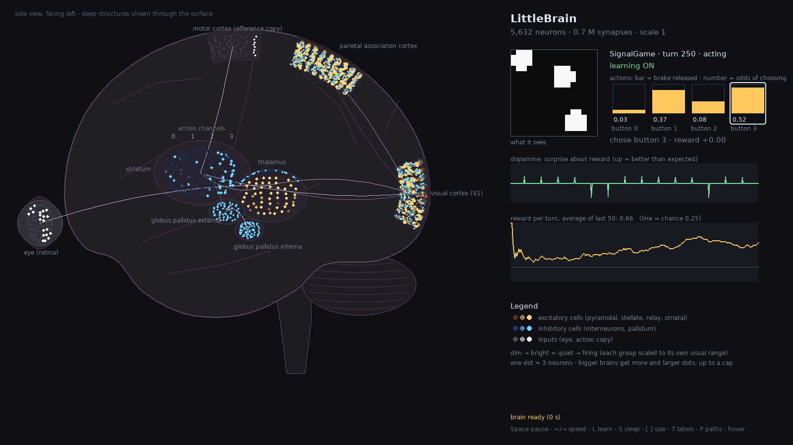

# 31: The desktop viewer

*2026-11-17. `prototype/viz/brainview.py` (pygame-ce). Screenshots: `docs/screenshots/`.*

## What it shows
- **A side view of a human brain** (facing left). Cortical areas are layered ribbons at the surface
  (L2/3 outermost → L6 innermost): area A at the visual pole, area B in parietal cortex, the motor strip on top.
  Thalamus (with the reticular nucleus as a shell), striatum and pallidum are deep nuclei; the eye is in front.
- **Every dot is real map position**: a small run of neighbouring neurons of one type, placed where they sit on the
  brain's 8×8 map, glowing with their current firing (warm = excitatory, cool = inhibitory, grey = inputs).
  Each group is coloured against its own usual range, so sparse cells (striatum) stay visible.
- **Brain size without clutter (level of detail):** a group gets at most ~7·√n dots (capped at 56–72). Small brains
  show one dot per neuron; bigger brains show more and larger dots, each standing for more neurons. The legend
  says how many neurons a dot stands for. Grow/shrink live with `[` `]` (0.25× – 4×; 1,728 – 22,528 neurons);
  a new size is grown once (calibration + development) and cached in `prototype/viz/.cache/`.
- **Hover a dot:** cell type, its human counterpart, which group, how many neurons, firing now.
- **Pathways** between regions brighten with their source's activity (`P` toggles).
- **Side panel, game-agnostic:** what the brain sees, its action channels (how far each brake is released, odds
  of choosing, the chosen one), dopamine, and reward per turn. Action names and an optional chance line come from
  the game; the viewer knows nothing else about it.

## Plugging in games
The viewer watches a `BrainAgent` playing any `games.Game` (`reset()` / `step(action)`; picture in, action out,
reward back). Register a game in `games.REGISTRY` and run `--game name`, or from code:
`watch(prepared_brain, make_game)`. The signal game is only the first test game.

## Run
    .venv/bin/python prototype/viz/brainview.py [--scale 1] [--seed 0] [--game signal]
    headless screenshots:  --shots 5,60,250 --out shots/  [--hover x,y]
Keys: Space pause · ←/→ speed · L learning on/off · S sleep · [ ] brain size · T labels · P pathways · F12 screenshot.
